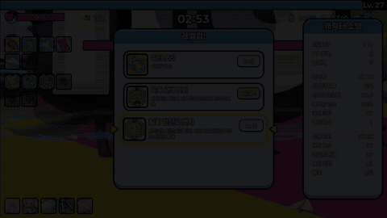
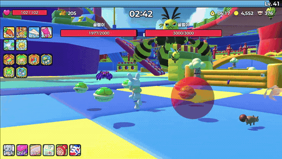
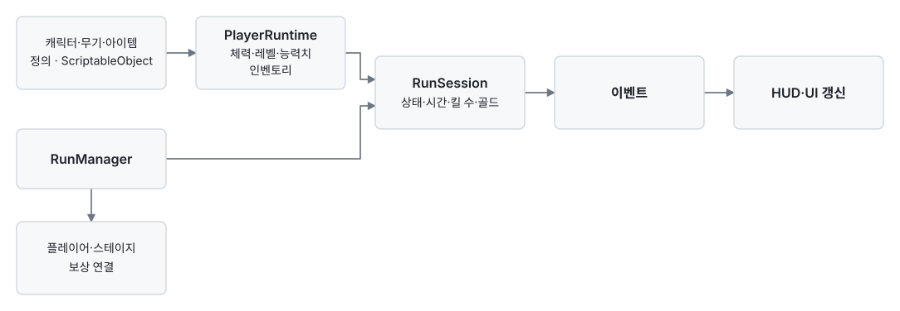
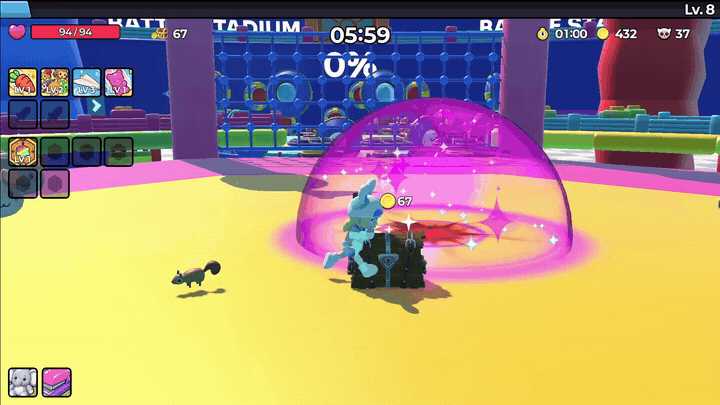
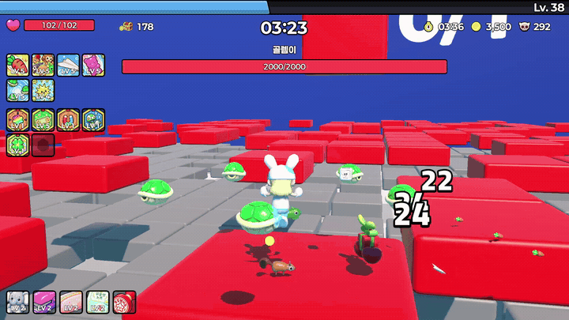
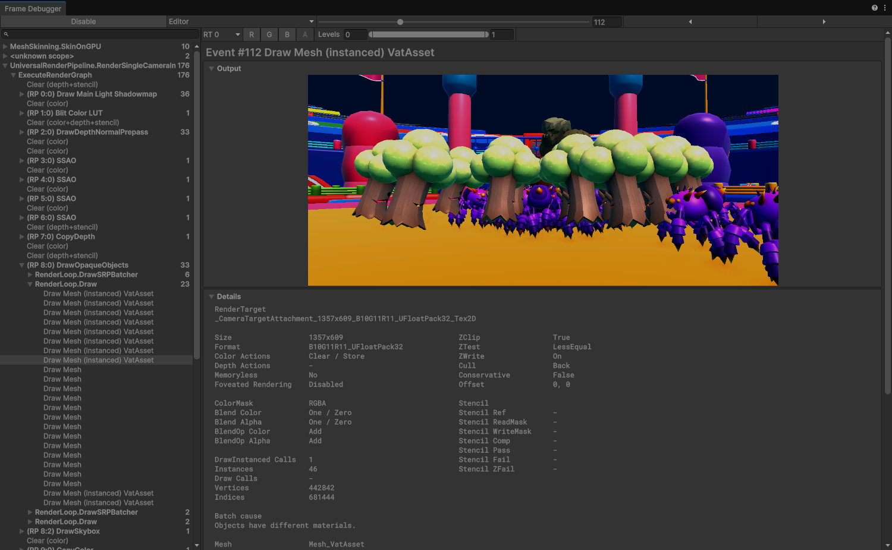

# 우당탕 방범대

**몬스터 무리와 싸우며 성장하고, 장애물을 돌파해 보스를 공략하는 3D 서바이벌 액션 게임**

귀여운 캐릭터를 선택해 적을 처치하고, 경험치를 모아 무기와 패시브를 조합합니다. 움직이는 발판과 고저차 지형을 넘어 보스의 공격 패턴을 피하며 스테이지를 진행합니다.

개발자 4인 팀에서 **팀장 · 코어 시스템 · 전투 판정**을 담당했습니다. 게임 진행 상태와 보상·UI 흐름을 연결하고, 몬스터 관리 구조 위에 플레이어 통과 방지·접촉 피해·피격 연출을 구현했습니다.

-  [상세 기술 포트폴리오 (PDF)](media/portfolio.pdf)
-  [플레이·구현 시연 영상](https://youtu.be/h3YhS_BtGJY)

  
  

## 프로젝트 정보

| 항목 | 내용 |
|---|---|
| 개발 기간 | 2026.05 ~ 2026.06, 1개월 |
| 팀 구성 | 4인, 개발자 4명 |
| 담당 역할 | 팀장 · 코어 시스템 · 전투 판정 |
| 엔진 · 언어 | Unity 6 · URP · C# |
| 플랫폼 | Windows PC |
| 주요 기술 | Addressables, UniTask, ScriptableObject, Kinematic Character Controller, DOTween |
| 몬스터 관리 기술 | 오브젝트 풀링, ManagedUpdate, 그리드 공간 분할, Raycast 기반 다층 지형 추적, VAT, GPU Instancing |

## 핵심 구현

### 1. 게임 진행 상태와 런타임 데이터

한 판의 진행 상태·시간·킬 수·골드를 `RunSession`에서 관리하고, `RunManager`가 플레이어와 스테이지·보상 시스템을 연결합니다. 진행·보상 선택·일시 정지·사망·클리어 상태에 따라 입력과 시간 흐름을 전환하고, 런 종료 시 이벤트 구독과 시스템 연결을 해제합니다.

캐릭터·무기·아이템의 정의는 ScriptableObject에 두고, 현재 체력·레벨·능력치·인벤토리는 런타임 객체로 관리합니다. 런타임 변경을 이벤트로 전달해 HUD와 게임 진행을 연결했습니다.

대표 코드: [RunManager](Scripts/Core/Bootstrap/RunManager.cs) · [RunSession](Scripts/GamePlay/Runtime/RunSession.cs) · [PlayerRuntime](Scripts/GamePlay/Runtime/PlayerRuntime.cs) · [EventBus](Scripts/Core/EventBus/EventBus.cs)

### 2. 비동기 UI와 보상 선택 흐름

UI 레지스트리에 등록된 화면과 팝업을 Addressables·UniTask로 로드하고 캐시합니다. 씬 UI·팝업·로딩 레이어를 나누고, 팝업 이력과 중복 초기화를 관리합니다. 리소스·씬 로드·캐릭터 서비스는 인터페이스로 등록해 게임 흐름에서 사용합니다.

레벨업 시 보상 선택 상태로 전환하고, 한 번에 오른 레벨 수만큼 선택을 순서대로 처리한 뒤 게임을 재개합니다. 상자 보상은 별도 흐름으로 분리했습니다.

골드로 상자를 열면 보상 카드가 순서대로 공개되고, 등장한 아이템을 획득합니다.

대표 코드: [UIManager](Scripts/UI/UIManager.cs) · [ResourceService](Scripts/Core/Resource/ResourceService.cs) · [ServiceBootstrapper](Scripts/Core/Bootstrap/ServiceBootstrapper.cs) · [LevelUpRewardFlow](Scripts/Core/Reward/LevelUpRewardFlow.cs) · [ChestRewardFlow](Scripts/Core/Reward/ChestRewardFlow.cs)

## 프로젝트 기술과 성능 검증

일반 몬스터는 Rigidbody 충돌·NavMeshAgent·Animator 대신 다음 구조로 관리합니다. **풀링·그리드·추적·VAT의 기반 구조는 팀원이 구현했으며**, 저는 이 구조에 통과 방지·접촉 피해·피격 연출·런 상태 연동을 구현했습니다. 아래 수치는 프로젝트 기술을 비교 측정한 결과입니다.

| 기술 | 구현 방식 | 대표 코드 |
|---|---|---|
| 풀링과 ManagedUpdate | 스폰·사망 시 풀 재사용, 활성 몬스터를 매니저 루프에서 일괄 갱신 | [EnemyManager](Scripts/GamePlay/Enemy/EnemyManager.cs) |
| 그리드 공간 분할 | 0.15초마다 셀 등록, 자기 셀과 인접 8셀에서 반경 안 이웃 최대 5마리의 분리 힘 합산 | [EnemyManager](Scripts/GamePlay/Enemy/EnemyManager.cs) |
| NavMesh 없는 3D 추적 | XZ 직선 추적과 지면 Raycast 결합, 높이 차이가 크거나 일반 검사 실패 시 다중 결과에서 플레이어 높이에 가까운 지면 선택 | [Enemy](Scripts/GamePlay/Enemy/Enemy.cs) |
| VAT + GPU Instancing | SmartVAT로 정점 애니메이션을 텍스처에 굽고, 같은 종류의 몬스터를 묶어 렌더링 | [몬스터 애니메이션 상태 제어](Scripts/GamePlay/Enemy/Enemy.cs) |

### 다층 지형 추적

고저차 발판에서의 플레이어 이동과 몬스터 추적 장면입니다.

### 성능 비교 · 몬스터 300마리

풀링·Update 호출 방식·VAT를 각각 **300마리 조건**에서 비교한 결과입니다.

| 비교 항목 | 변경 전 | 적용 후 | 측정 조건 |
|---|---:|---:|---|
| 스폰 1회 GC 할당 | 1,090 B | 평균 약 24 B | 300마리 유지, 초당 약 97마리 교체 |
| 프레임당 스크립트 Update 시간 | 3.69 ms | 3.19 ms | 300마리, 개별 Update와 매니저 순회 비교 |
| 프레임당 메인 스레드 시간 | 12.8 ms | 6.4 ms | 같은 모델 300마리, Animator와 VAT 비교 |
| 몬스터 배치에 따른 드로우콜 증가분 | 약 2,316개 | 약 21개 | 같은 모델 300마리, 빈 씬 대비 증가분 |

Windows Development Build, Unity 6000.4.5f1, Ryzen 5 5600G·내장 Radeon Graphics, 렌더 스케일 0.3에서 측정했습니다. 풀링·Update 비교는 60 FPS 상한을 적용했고, VAT 비교는 FPS 상한 없이 **추적·전투를 제외한 렌더링만** 비교했습니다. 자세한 지표 정의와 1,000마리 추가 측정은 [성능 측정 문서](docs/performance.md)에 정리했습니다.

**당시 저장한 300마리 Frame Debugger 캡처**입니다. 몬스터 7종을 배치한 별도 에디터 검증에서, 같은 종류 46마리가 한 번의 드로우콜로 묶이는 것을 확인했습니다(`Instances 46`). 위 표의 CPU 시간은 Development Build의 CSV 측정값입니다.

## 공개 범위

이 저장소는 **개발 포트폴리오 검토를 위한 소스 열람용 저장소**입니다.

- `Scripts/`: 프로젝트 C# 코드. 본인 담당 코드와 연관된 팀 프로젝트 코드를 함께 포함합니다.
- `media/`: 상세 포트폴리오 PDF, 실제 플레이 GIF·이미지, 렌더링 테스트·프로파일링 자료.
- `docs/`: 성능 측정 조건과 비교에 사용한 요약 CSV.
- Unity Scene·Prefab·프로젝트 설정·원본 아트·폰트·음원·외부 SDK와 라이브러리 원본은 포함하지 않아 **이 저장소만으로 실행하거나 빌드할 수 없습니다.**
- 외부 의존성에는 Addressables, UniTask, DOTween, Kinematic Character Controller, Cinemachine, SmartVAT 등이 있습니다. 외부 라이브러리·도구·에셋은 각 제공처의 이용 조건을 따릅니다.
- 진단·캡처 도구, 내부 작업 문서, 로컬 경로와 원본 저장소의 커밋 이력은 공개본에 포함하지 않습니다.

코드와 자료에 별도의 오픈소스 이용 허락을 선언하지 않습니다. 재사용·재배포 시 권리자의 허락과 관련 라이선스를 확인해주세요. 팀 제작 자료와 외부 에셋의 권리는 해당 권리자에게 있습니다.
