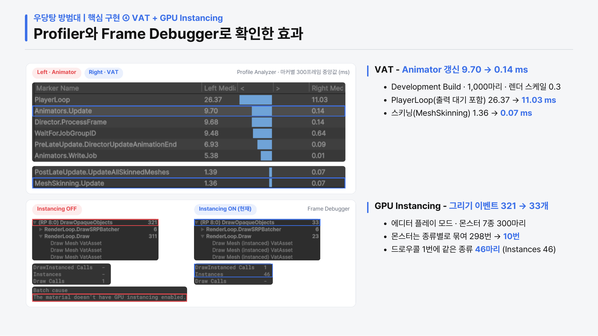

# 성능 측정 조건과 결과

[README로 돌아가기](../README.md) · [상세 포트폴리오](../media/portfolio.pdf)

2026-10-12에 남긴 비교 측정의 요약입니다. 게임 코드의 성능을 새로 측정한 결과가 아니라 기존 Development Build 측정 기록을 정리한 자료입니다. 포트폴리오 PDF의 네 가지 프로젝트 기술과 관련되며, 기반 몬스터 구조의 구현 기여는 README에 별도로 표시했습니다.

## 공통 환경

| 항목 | 값 |
|---|---|
| 엔진 | Unity 6000.4.5f1, URP |
| 빌드 | Windows Development Build, Direct3D 11 |
| CPU | AMD Ryzen 5 5600G |
| GPU | AMD Radeon Graphics, 내장 그래픽 |
| 메모리 | 약 16 GB |
| 출력 해상도 | 1920 × 1080 |
| CPU 비교 조건 | URP 렌더 스케일 0.3 |
| 측정 구간 | 기본 안정화 6초, 케이스당 약 10초 측정 |

렌더 스케일 0.3은 내장 GPU의 병목을 줄여 CPU 쪽 차이를 관찰하기 위한 조건입니다. 1080p 출시 설정의 전체 플레이 FPS로 해석하면 안 됩니다. 요약 CSV의 지표는 서로 포함 관계가 있을 수 있으므로 합산하지 않습니다.

## 1. 풀링

300마리를 유지하며 초당 약 97마리를 스폰·회수했습니다. 접촉 피해를 끈 동일 조건에서 풀 재사용과 Instantiate·Destroy를 번갈아 2회씩 비교했습니다.

| 지표 | Instantiate·Destroy | 풀 재사용 |
|---|---:|---:|
| 스폰 1회당 GC 할당, 1회차 | 1,090 B | 약 24.1 B |
| 스폰 1회당 GC 할당, 2회차 | 1,090 B | 0 B |

원자료: [churn3/summary.csv](benchmarks/churn3/summary.csv)

`manualGcBytesTotal / churnSpawned`로 스폰·회수 구간의 1회당 평균 할당을 계산합니다. CSV의 `gcBytesAvg`는 프레임 전체의 할당이라 이 값과 다릅니다. README는 잔여 할당이 있던 1회차를 반올림해 약 24 B로 표시했습니다.

실제 가장 빠른 웨이브에 가까운 초당 약 15마리 조건도 [churnReal2/summary.csv](benchmarks/churnReal2/summary.csv)에 함께 제공합니다. 이때 풀링은 약 25.1 B, Instantiate·Destroy는 1,090 B이며 두 방식 모두 약 60 FPS입니다.

## 2. ManagedUpdate

300마리, 렌더 스케일 0.3, 60 FPS 상한에서 같은 `ManagedUpdate`를 호출하는 방식만 바꾸어 번갈아 3회씩 측정했습니다.

| 방식 | 1회 | 2회 | 3회 | 평균 |
|---|---:|---:|---:|---:|
| 몬스터마다 Update | 3.67 ms | 3.78 ms | 3.62 ms | 3.69 ms |
| 매니저 순회 | 3.20 ms | 3.30 ms | 3.06 ms | 3.19 ms |

원자료: [selfAB/summary.csv](benchmarks/selfAB/summary.csv)

비교 지표는 씬의 모든 스크립트 Update 시간을 합친 `scriptUpdateMsAvg`입니다. 개별 Update 케이스의 `emAvgMs`는 매니저에 남은 그리드 갱신 시간만 포함하므로 이 비교에 사용하지 않습니다. 프레임률 상한 때문에 FPS보다 CPU 소요 시간을 비교합니다.

## 3. 그리드와 지면 검사

그리드는 0.15초, 일반 몬스터 지면 검사는 0.1초 간격으로 갱신합니다. 300마리, 렌더 스케일 0.3, 60 FPS 상한의 기본 케이스에서 `EnemyManager.Update` 평균은 **2.99 ms**입니다.

원자료: [cpu60/summary.csv](benchmarks/cpu60/summary.csv), `base` 행의 `emAvgMs`.

이 시간에는 그리드·분리·추적·지면 검사 등 매니저의 전체 갱신이 포함됩니다. Rigidbody나 NavMeshAgent와 동일 기능을 수행하는 비교군을 측정한 값이 아니며, 일반적인 경로 탐색 성능 비교로 사용할 수 없습니다. 지형 추적은 XZ 직선 이동과 Raycast 높이 보정이며, 장애물을 우회하는 전역 경로 탐색은 제공하지 않습니다.

## 4. VAT 렌더링 비교

같은 모델 1,000마리를 배치하고 Animator + SkinnedMeshRenderer와 VAT를 비교했습니다. 렌더 스케일 0.3, FPS 상한 없음, **몬스터 추적·전투 제외** 조건입니다.

| 지표 | Animator | VAT |
|---|---:|---:|
| 메인 스레드 시간 (`ftMainMs`) | 26.84 ms | 6.37 ms |
| 프레임률 | 37.2 FPS | 92.4 FPS |
| 빈 씬 대비 드로우콜 증가분 | 약 5,123개 | 약 22개 |

원자료: [vatLowb/summary.csv](benchmarks/vatLowb/summary.csv), `empty`·`skin1000`·`vat1000` 행.

메인 스레드 시간은 `FrameTimingManager`의 `ftMainMs`이며, 출력 대기가 포함된 `mainThreadMsAvg`·PlayerLoop 프레임 시간과 다릅니다. 드로우콜은 `dcStandardAvg`·`dcInstancedAvg`·`dcSrpBatcherAvg`·`dcBrgAvg`·`dcBrgIndirectAvg`의 합에서 빈 씬 값을 빼고 반올림했습니다. 씬의 다른 그리기 변동도 소량 포함되므로 몬스터만의 정확한 이벤트 수로 해석하지 않습니다. PDF의 5,121 → 21개와는 집계·정수 표기가 조금 다릅니다.

Animator 케이스는 배치한 1,000개 중 925개가 화면 안으로 판정됐고 VAT는 1,000개였습니다. 이 가시성 차이가 있어 완전히 동일한 렌더러 수를 그리는 비교로 보아서는 안 됩니다. 수치는 해당 모델·머티리얼·카메라 구성에 한정됩니다.

## Profiler·Frame Debugger 확인

- Profile Analyzer: 별도 Development Build 기록의 300프레임 중앙값입니다. VAT 적용 시 Animator 갱신은 약 9.70 → 0.14 ms, MeshSkinning은 약 1.36 → 0.07 ms입니다. 기록 부하와 지표가 달라 위 CSV의 메인 스레드 시간과 같은 값으로 사용하지 않습니다.
- Frame Debugger: 에디터 플레이 모드의 몬스터 7종·300마리입니다. 한 카메라의 불투명 패스에서 몬스터 그리기는 298 → 10번, 패스 전체 이벤트는 321 → 33개로 바뀌었습니다. 화면 전체 드로우콜이나 위 1,000마리 실험과 다른 범위입니다.

## 해석의 한계

- 내장 그래픽 PC 한 대의 결과이며 다른 하드웨어의 성능을 보장하지 않습니다.
- 전체 씬에는 카메라 중복 렌더링 비용이 있었고, 밀집 시 이웃 탐색 비용과 지면 검사 주기가 같은 프레임에 모이는 문제가 관찰됐습니다. 개별 기술의 개선율을 전체 게임의 개선율로 일반화하지 않습니다.
- 렌더링 테스트의 1,000마리 배치 화면은 실제 1,000마리 전투가 목표 FPS를 유지했다는 근거가 아닙니다.
- 이 공개본에는 Unity 씬·프리팹·원본 에셋이 없어 측정 빌드를 재구성할 수 없습니다. 제공한 CSV는 기존 측정의 요약 원자료이며, 대용량 Profiler 기록과 프레임별 원자료는 포함하지 않았습니다.
